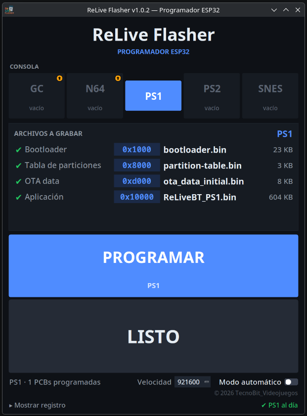
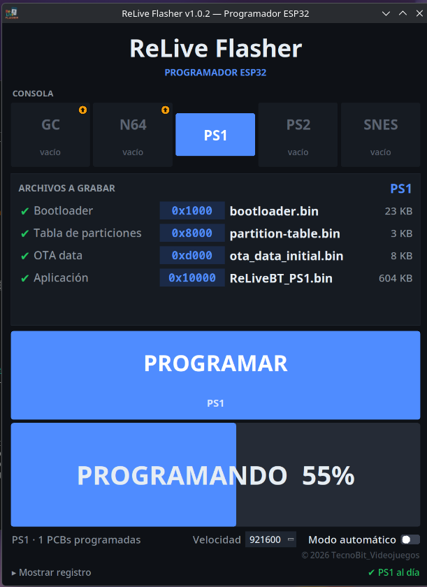
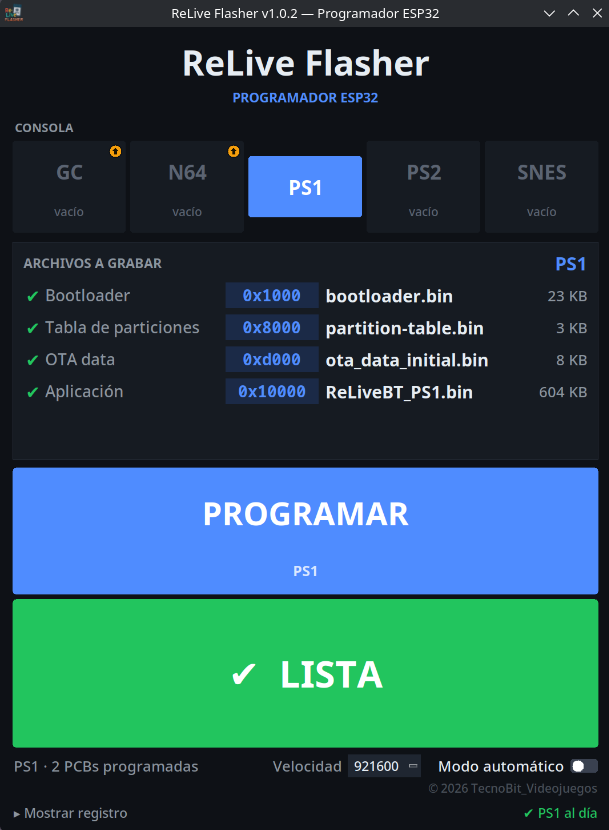
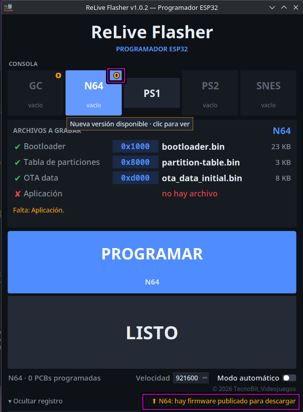
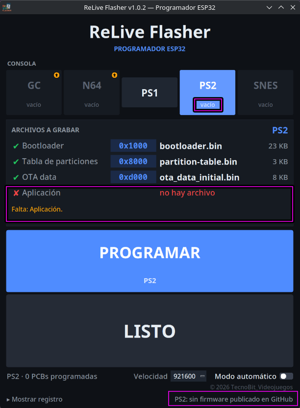
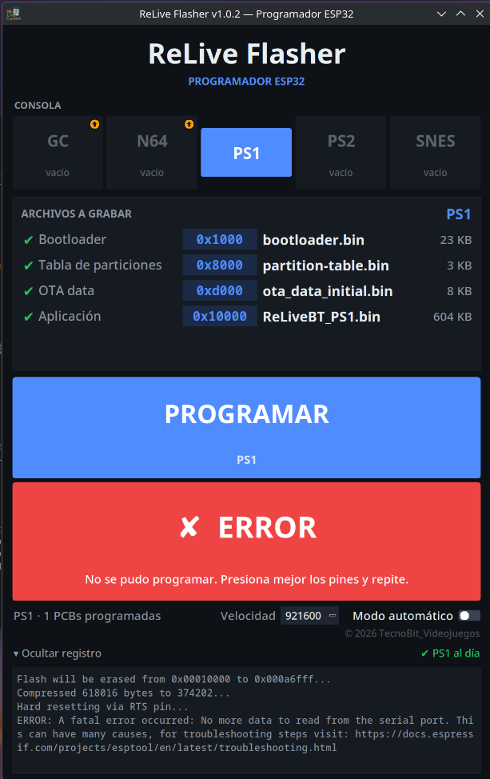

# ReLive Flasher

[](https://github.com/TecnoBit-Videojuegos/ReLive-Flasher/releases/latest)
[](LICENSE)


A simple desktop tool to program the boards of the **ReLiveBT** Bluetooth controllers (GameCube, N64, PS1, PS2 and SNES).
Pick a console, press the PCB against the programmer and hit **Space** or **Enter**. No command line, no Python, nothing to install.

The firmware itself lives in [TecnoBit-Videojuegos/ReLiveBT-Controller](https://github.com/TecnoBit-Videojuegos/ReLiveBT-Controller).
This repository is only the programming tool.

> The program interface is in Spanish. A short [glossary](#interface-glossary) is included below.



## What it does

- **Programs a board in one click.** Click **PROGRAMAR**, or press **Space** or **Enter**.
- **Writes everything the board needs:** bootloader, partition table, OTA data (when the console has it) and the application,
  each at the address defined in that console's partition table.
- **One button per console.** The *Archivos a grabar* card shows each file with a green check or a red cross, its address and
  its size, and says exactly what is missing.
- **Manual mode:** you press the PCB against the programmer and start each board yourself.
- **Automatic mode:** made for production. It waits for a PCB, programs it, and waits until you remove it before the next one.
- **Finds the USB programmer by itself** (CH340/CH9102, CP210x and FTDI adapters).
- **Counts the PCBs** you have programmed, per console.
- **Remembers** your last console, speed and mode.
- **Tells you when there is new firmware.** It checks GitHub once, when the program starts. Nothing is downloaded unless you say so.
- **Works offline** with the files you already have.

## Download

Get the latest version from the **[Releases page](https://github.com/TecnoBit-Videojuegos/ReLive-Flasher/releases/latest)**.
It always shows only the newest version; new releases are built automatically.

| System           | File                              | How to run                                          |
| ---------------- | --------------------------------- | --------------------------------------------------- |
| Windows (64-bit) | `ReLive-Flasher-windows-x64.zip`  | Extract it, then run `ReLive-Flasher.exe`           |
| Linux (x86-64)   | `ReLive-Flasher-linux-x64.tar.gz` | Extract it, then run `ReLive-Flasher/ReLive-Flasher` |

Extract the **whole folder** and keep it together (do not run the program from inside the zip). The firmware, your settings
and the PCB counters are stored inside it, so you can move the folder anywhere.

**Windows**

- The first time, SmartScreen may say *"Windows protected your PC"*, because the program is not code-signed.
  Click **More info → Run anyway**.
- Plug in the programmer and check that a new entry appears in **Device Manager → Ports (COM & LPT)**. If it does not,
  install the driver from the chip maker (WCH for CH340/CH9102, Silicon Labs for CP210x, FTDI for FTDI).

**Linux**

- Built on Ubuntu 24.04, so it needs **glibc 2.39 or newer** (Ubuntu 24.04+, Fedora 40+, Debian 13+, Arch-based systems such as CachyOS).
- Your user needs permission to use serial ports. Run one of these, then log out and in again:
  - Arch / CachyOS / Manjaro: `sudo usermod -aG uucp $USER`
  - Debian / Ubuntu / Fedora: `sudo usermod -aG dialout $USER`

## How to use it

### Manual mode

1. Plug in the USB programmer. It is detected automatically.
2. Choose the console with the buttons at the top.
3. In the **Archivos a grabar** card, every file needs a green check. If something is missing, the card tells you what.
4. Press the PCB firmly against the programmer pins.
5. Click **PROGRAMAR**, or press **Space** or **Enter**.
6. The big banner shows the progress (**PROGRAMANDO 40%**). When it turns green and says **✔ LISTA**, the board is done.




### Automatic mode

For many boards in a row, choose the console and switch on **Modo automático** (bottom right).

1. The banner says **ESPERANDO PCB** (waiting for a PCB).
2. Press a PCB against the programmer. The program detects it and programs it by itself; no key is needed.
3. When it finishes you see **✔ LISTA — Retira la PCB y pon la siguiente** (remove the PCB and put the next one).
4. The program will not program again until you take that PCB away. Once it is removed, it goes back to waiting.

Every successful board adds one to that console's counter, shown at the bottom left (for example *N64 · 12 PCBs programadas*).

### Speed

**Velocidad** is the programming speed (115200 to 921600, default 921600). If programming is unstable because of long cables or
poor contact, choose a lower value.

### Interface glossary

| You see                             | It means                                         |
| ----------------------------------- | ------------------------------------------------ |
| **PROGRAMAR**                       | Program the board                                |
| **ELIGE UNA CONSOLA**               | Choose a console first                           |
| **LISTO**                           | Ready, waiting for you to start (manual mode)    |
| **ESPERANDO PCB**                   | Waiting for a PCB (automatic mode)               |
| **CONECTANDO... / PROGRAMANDO 40%** | Connecting to the board / programming it         |
| **✔ LISTA**                         | Board programmed successfully                    |
| **✘ ERROR**                         | Programming failed; see the message and try again |
| **FALTAN ARCHIVOS**                 | Files are missing in that console's folder       |
| **SIN PROGRAMADOR**                 | No USB programmer found                          |
| **Modo automático**                 | Automatic mode                                   |
| **Velocidad**                       | Programming speed                                |
| **Mostrar registro**                | Show the log (the full detail of what happened)  |

## Firmware files

Each console has its own folder inside `firmware/`:

```
ReLive-Flasher/
├── ReLive-Flasher (.exe on Windows)
├── firmware/
│   ├── GameCube/
│   ├── N64/
│   ├── PS1/
│   ├── PS2/
│   └── SNES/
└── ...
```

Every console folder holds four kinds of files:

- `bootloader.bin`, `partition-table.bin` and `ota_data_initial.bin`: the same for every console, **already included** in the download.
- **The application `.bin`**: the only one that changes with each firmware version. The program can download it for you
  (see below), or you can copy it into the console's folder yourself. If a folder has more than one, the most recent is used
  and a warning is shown.

To add another console, create a new folder inside `firmware/` with those files. It appears as a new button.

## Firmware updates

When the program starts, it checks whether newer firmware is published for each console (it looks for `ReLiveBT_<CONSOLE>.bin`
in the [ReLiveBT-Controller releases](https://github.com/TecnoBit-Videojuegos/ReLiveBT-Controller/releases)).

- If there is something new, that console's button shows a small yellow indicator, and the text at the bottom right says
  *Actualización disponible* (update available). If everything is current it says *al día* (up to date).
- Click the button to see the new version and choose whether to download it. **Nothing is downloaded until you press
  Descargar.**
- The download is verified, and your previous file is kept in a `_backup` folder inside the console's folder, so you can always go back.
- With no internet connection, the program simply works with the files it already has.



If a console has no application file yet, the program tells you what is missing and offers the same download.



## When something goes wrong

If a board cannot be programmed, the banner turns red and shows the reason. Fix the cause and try again; press
**Mostrar registro** to read the full detail.



| Symptom                                           | What to check                                                                                                           |
| ------------------------------------------------- | ----------------------------------------------------------------------------------------------------------------------- |
| **SIN PROGRAMADOR**                               | Check the USB cable. Windows: the adapter must appear under *Ports (COM & LPT)*. Linux: your user must be in `uucp` / `dialout`. |
| Programmer plugged in but not detected            | Only CH340/CH9102, CP210x and FTDI adapters are recognised automatically.                                               |
| **FALTAN ARCHIVOS**, or a red cross in the card   | That file is missing in the console's folder. Download it with the firmware update, or copy it there.                   |
| **✘ ERROR** ("Presiona mejor los pines")         | The PCB is not making good contact. Press the pins firmly and try again.                                                |
| Programming fails or stops half-way               | Check the contact, then choose a lower **Velocidad**. The log shows the details.                                        |
| "Could not download: HTTP Error 504"              | A temporary GitHub problem. The program already retries by itself; press **Reintentar** a bit later.                    |
| The window opens in a strange place               | Delete `config.json` (it is in the program folder) and open the program again.                                          |

## License and credits

Released under the **GNU General Public License v3.0**, see [LICENSE](LICENSE). It bundles
[esptool](https://github.com/espressif/esptool) (GPL-2.0-or-later) and [pyserial](https://github.com/pyserial/pyserial) (BSD).

© 2026 TecnoBit Videojuegos
